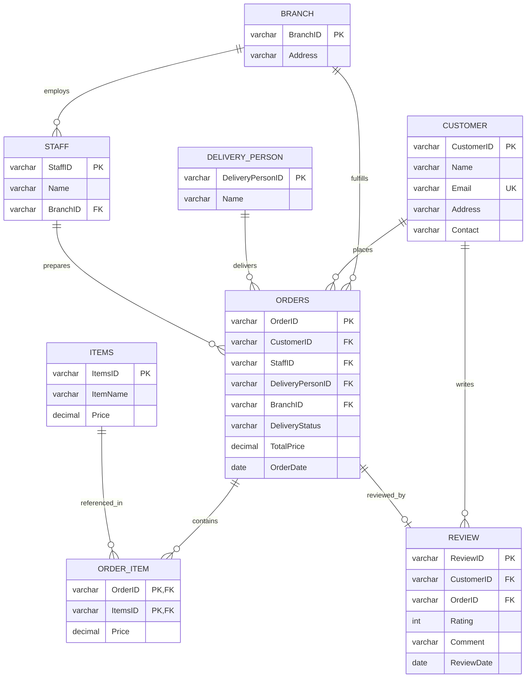

# 🍕 "Delicious Pizza" Food Ordering & Delivery Database System

[-00758F?style=for-the-badge&logo=mysql&logoColor=white)](file:///schema.sql)
[-success?style=for-the-badge)](file:///schema.sql)
[](file:///schema.sql)
[](file:///queries.sql)

> An enterprise relational database system designed from scratch to manage online ordering, branch distribution, order preparation, real-time courier delivery, and customer review feedback for **Delicious Pizza**, a rapidly growing multi-branch pizza restaurant chain.

---

## 📌 Executive Summary

Modern food ordering applications require high concurrency, zero data redundancy, strict referential integrity, and sub-second query latency. This project implements a fully normalized **3rd Normal Form (3NF)** relational database system covering the complete lifecycle of food delivery:
1. **Store & Branch Management:** Handling multiple restaurant branches and assigning staff.
2. **Customer Profiles:** Storing secure contact information and primary delivery addresses.
3. **Menu Catalog:** Dynamic item pricing and order breakdown lines.
4. **Order Fulfillment:** Dispatching orders to couriers, tracking delivery lifecycle statuses (`Pending`, `Out for Delivery`, `Delivered`).
5. **Quality Assurance & Feedback:** Post-delivery customer ratings (1–5 scale) and qualitative feedback.

---

## 📐 Entity-Relationship Diagram (ERD)

The database consists of **8 interconnected tables** structured in 3NF to eliminate insertion, update, and deletion anomalies.



---

## 🗄️ Database Dictionary & Schema

| Entity | Primary Key | Foreign Keys | Key Attributes & Constraints | Business Role |
|---|---|---|---|---|
| **`Branch`** | `BranchID` | None | `Address` | Physical pizza restaurant branches. |
| **`Staff`** | `StaffID` | `BranchID` | `Name` | Restaurant branch employees preparing orders. |
| **`DeliveryPerson`** | `DeliveryPersonID` | None | `Name` | Dispatch couriers assigned to delivery runs. |
| **`Customer`** | `CustomerID` | None | `Name`, `Email` (UNIQUE), `Address`, `Contact` | Registered client profiles. |
| **`Items`** | `ItemsID` | None | `ItemName`, `Price` (CHECK `Price >= 0`) | Menu items and unit prices. |
| **`Orders`** | `OrderID` | `CustomerID`, `StaffID`, `DeliveryPersonID`, `BranchID` | `DeliveryStatus`, `TotalPrice`, `OrderDate` | Order transactions and delivery state tracking. |
| **`OrderItem`** | `(OrderID, ItemsID)` | `OrderID`, `ItemsID` | `Price` | Composite bridge entity resolving M:N items in an order. |
| **`Review`** | `ReviewID` | `CustomerID`, `OrderID` | `Rating` (1–5 CHECK), `Comment`, `ReviewDate` | Customer satisfaction feedback. |

---

## 💡 Key SQL Analytical Queries (DML)

The project includes **15 comprehensive SQL queries** addressing key business, operational, and customer intelligence questions:

1. **High-Value Orders:** Identifies orders exceeding \$50.00 sorted descending for VIP customer profiling.
2. **Monthly Delivery Audits:** Filters all delivered orders in October 2023 with date-range clipping.
3. **Minimum Order Value:** Uses `MIN()` aggregation grouped by customer to detect entry-level basket sizes.
4. **Item-Level History:** Uses a 4-table `INNER JOIN` to locate all items ordered by customer `"Sarah"`.
5. **Branch Service Rating:** Computes `AVG(Rating)` per restaurant branch to benchmark branch quality.
6. **Cohort Segmentation:** Extracts customer contact details for anyone who ordered `"Hawaiian Pizza"`.
7. **Driver Revenue Contribution:** Computes cumulative sales delivered per courier to calculate commissions.
8. **Top-Selling Item:** Calculates total units sold and revenue per item to guide kitchen inventory.
9. **Monthly Cohort Tracking:** Retrieves October 2024 active customer order transactions.
10. **Churn & Inactive Customer Discovery:** Uses `LEFT JOIN ... WHERE o.OrderID IS NULL` to find users who have never placed an order for re-engagement marketing.
11. **Order Summary Master View:** Combines Customer, Orders, and Branch tables for transaction tracking.
12. **Dispatcher Queue Audit:** Evaluates unassigned orders using `LEFT JOIN` and `COALESCE()` to flag fulfillment bottlenecks.
13. **5-Star Quality Correlation:** Links top reviews with the specific branch and delivery personnel responsible.
14. **Fleet Utilization Metrics:** `LEFT JOIN` on delivery personnel to show workload including couriers with zero deliveries.
15. **Customer Lifetime Value (CLV):** Aggregates lifetime spending per customer, handling zero-spend accounts with `COALESCE()`.

---

## 🚀 Getting Started & Execution

The scripts are ANSI SQL standard and compatible with **PostgreSQL, MySQL, Microsoft SQL Server, and SQLite**.

### 1. Run via MySQL / MariaDB
```bash
# Clone the repository
git clone https://github.com/YOUR_USERNAME/delicious-pizza-database-system.git
cd delicious-pizza-database-system

# Execute schema, sample data, and queries
mysql -u root -p < schema.sql
mysql -u root -p < sample_data.sql
mysql -u root -p < queries.sql
```

### 2. Run via PostgreSQL
```bash
psql -U postgres -d postgres -f schema.sql
psql -U postgres -d postgres -f sample_data.sql
psql -U postgres -d postgres -f queries.sql
```

### 3. Run via Python / SQLite (Instant Local Test)
```python
import sqlite3

conn = sqlite3.connect("pizza.db")
with open("schema.sql") as f: conn.executescript(f.read())
with open("sample_data.sql") as f: conn.executescript(f.read())
with open("queries.sql") as f:
    for q in f.read().split(";"):
        if q.strip(): conn.execute(q)
print("All tables and queries verified successfully!")
```

---

## 👤 Author

- **Chan Hua Shean**
- Asia Pacific University of Technology & Innovation (APU)
- Bachelor of Computer Science (Hons) in Artificial Intelligence
- [LinkedIn Profile](https://www.linkedin.com/in/chanhuashean) · [Email](mailto:hschan0420@gmail.com)
